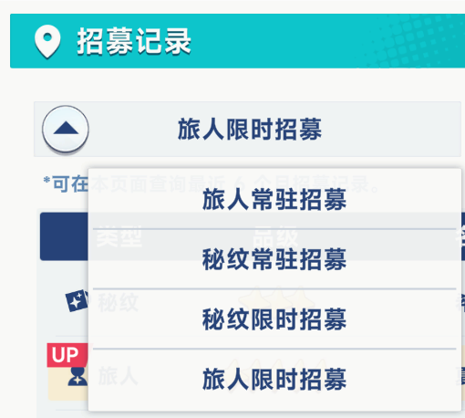

# 星塔旅人抽卡记录工具

## 下载 Windows 版本

在 [最新发布页](https://github.com/sfjdk/StellaSoraTracker/releases/latest) 下载 Windows 免安装 ZIP，完整解压后运行 `StellaSoraGachaTool.exe`，无需安装 Python。升级前备份旧目录中的 `exports`，再将其复制到新版程序旁；不要只复制单个 exe。

已发布版本的更新与校验说明见 [v1.2.26 更新日志](docs/releases/v1.2.26.md)。下面的自动上传与更新功能已加入源码，等待用户明确要求后再发版。

## 自动上传与软件更新

在「数据与设置 → 自动上传与更新」控制两个独立开关，选择会随主题偏好一起保存在 `exports/ui_settings.json`，切换主题或账号后仍然有效。

- **自动上传（默认关闭）**：成功抓取或导入记录后，将对应 UID 的完整归档上传到蕾姆。使用与 [zhenkotone/stellasora_gacha](https://github.com/zhenkotone/stellasora_gacha/blob/main/stellasora_toolkit/upload.py) 一致的接口 `https://yostar.772077.xyz:7777/stellasora/api/gacha/upload`，不需要登录或 Token。按账号和上传地址记录成功指纹，未变化的归档不重复上传；上传失败不会改动本地归档，下次抓取或导入时可再次尝试。关闭后仍可在「上传与分享」手动上传。
- **自动更新（默认开启）**：Windows 发行版启动时检查更新，没有每 6 小时定时检查。发现新版先询问是否下载，完成 SHA-256 校验后再询问是否重启安装；抓取或上传进行时会等待空闲。关闭开关会停止自动检查、取消自动下载及待安装提示，手动检查不受影响。源码模式不自动更新。共同仓库的更新源与渠道尚待确定，本次没有修改现有清单。

上传成功表示归档已暂存，**每次仍需向蕾姆发送「星塔抽卡绑定 UID …」指令确认正式更新**；指令显示在「上传与分享」中。自动上传不会代发绑定指令。

开发验证：`./.venv/Scripts/python.exe tools/run_tests.py`，Qt 测试在离屏模式运行并及时释放测试窗口。

## 界面主题

提供三套原生 PySide6 界面，首次默认使用星轨夜航，可在“数据与设置 → 界面主题”切换。程序会记住选择，下次启动自动恢复；切换时保留归档、卡池筛选、搜索条件和五星/全部记录浏览模式：

| 方向 | 风格 |
| --- | --- |
| A · 星轨夜航 | 深海蓝、头像星轨、侧栏导航 |
| B · 晴空工作台 | 冰蓝白、清晰统计、左侧导航 |
| C · 旅人手札 | 雾紫纸张、相遇照片、卡池档案 |

首次运行先安装项目依赖：`python -m venv .venv`，然后 `./.venv/Scripts/python.exe -m pip install -e .`。

三套主题的菜单均在左侧。主题、卡池列数和自动化偏好保存在输出目录的 `ui_settings.json`，账号切换不影响偏好。卡池详情可选择自动排布、一列、两列，并在重启后恢复。

应用始终加载本地归档；公开命令行中的 `--demo`、`--beta` 和演示启动脚本已移除。测试工具内部可使用内存样例做离屏验证。读取游戏时仍需按原使用说明以管理员权限运行。

打开 [三套 UI 截图预览](ui-beta/index.html) 可切换查看首页、记录页、设置页和 960px 小窗口效果。截图由真实 Qt 控件渲染，使用演示记录。原生窗口支持卡池筛选、名称搜索、五星/全部记录切换、归档导入、JSON/CSV 导出、备份和更新检查。

重新生成截图：`./.venv/Scripts/python.exe tools/render_ui_betas.py`。

## 软件是做什么的

本地整合分支按 [人工判断记录](docs/integration-decisions.json) 实施，引用的上游文件和原始哈希见 [上游来源记录](docs/upstream-imports.json)。8 项待议和 1 项暂缓保持现状：归档目录、内存解析策略、资源人工核对、绑定提示、更新渠道与清单、构建方案、许可证和版本号，以及全局导航。未修改版本号或更新清单，也未发版。

## 读取与归档保护

- 多开客户端时按进程名、PID 和路径选择具体实例；命令行可组合 `--server tw --pid 1234`。台服 UID 适配已通过模拟内存测试，实际客户端兼容性仍需实机验收。
- 实际读取不沿用手填或旧 UID。读取前后必须确认唯一 UID 及同一游戏进程启动时间；同一启动会话内切号或出现歧义会写入阻断标记，重启工具不能解除，需要重启游戏。
- 保存和上传前检查其他 UID 的异常重复记录。已有归档不能仅凭手填 UID 重新归属，也不能合并不同 UID 或归属未确认的旧档。
- 无 UID 的旧档保留在原位置及默认账号目录，不自动并入新读取的 UID。主归档损坏时，界面可读取有效的历史导出供核对，但不会自动覆盖主归档：先备份整个 `exports`，核对 UID，再从该账号的备份恢复 `stellasora_gacha_archive.json` 后重新读取。
- 周年特选分类 `6` 在抓取、导入、CSV、合并、分享和上传中保留，与普通限时池分开统计。上传服务是否接受分类 `6` 需要单独联调。
- 首页 UP 保底进度与记录页两次五星间隔分别计算；普通旅人限时池的 120 抽奖励只参与展示，不改归档、抽数或五星统计。

这是一个面向《星塔旅人》Windows 客户端(国服、国际服与日服)的非官方抽卡记录整理工具。

软件可以读取并保存五类招募记录：

- 旅人限时招募
- 秘纹限时招募
- 旅人常驻招募
- 秘纹常驻招募
- 周年特选招募（原始分类 `6`，卡池 `1001`，独立 160 抽保底）

界面会统计总抽数、五星数量、当前垫抽和五星间隔。限时卡池会按具体卡池展示官方名称、活动时间、实际抽数，以及五星结果的 `UP` 或 `歪`。历史记录会持续合并到本地归档，不会因为官方只保留近期记录而主动删除旧数据。

## 怎么实现的

软件通过 Windows `ReadProcessMemory`，只读访问游戏客户端当前已经加载到 Lua 运行时中的招募历史。

- 不抓包，不运行本地代理服务器。
- 不注入 DLL。
- 不修改游戏文件或游戏内存。
- 不模拟点击，不发送游戏协议请求。
- 每次读取时动态查找 Lua 数据，不依赖固定内存地址。

读取结果会整理为本地 JSON/CSV，并合并保存到 `exports/accounts/<账号>/stellasora_gacha_archive.json`。老版根目录归档会复制迁移，原文件保留。角色与秘纹头像只用于本地界面展示。

## 使用流程

0. 不需要手动选择服务器: 工具自动检测运行中的客户端(国服 `xtlr.exe`；国际服与日服共用 `StellaSora.exe`)。
   - 恰有一个客户端在运行且只对应一个版本 → 自动识别并读取;
   - 国服与 `StellaSora.exe` 同时运行 → 点击“抓取抽卡记录”时弹窗让你选择本次要读取的服务器;
   - **国际服与日服共用同一个客户端**, 进程名区分不出来 → 在「设置 → 游戏版本」点一次「日服」即可(会记住);
   - 「设置 → 游戏版本」可随时手动指定(保存到 `server.json`), 卡池名/角色名/UP 判定按所选服务器的语言显示(简中 / 英文 / 日文)。
1. 启动并登录《星塔旅人》，进入游戏主界面。
2. 在游戏中依次打开需要读取的招募记录（包括周年特选），并等待每个记录列表显示出来。



3. 以管理员身份运行本工具，点击“抓取抽卡记录”。
4. 等待读取完成，在首页和“招募记录”页面查看结果。
5. 新角色和秘纹图片会随软件版本内置更新；发现新版本时使用“检查更新”。

游戏不会在登录时一次性加载全部招募历史。未在游戏内打开的分类可能无法读取，软件会在界面中显示当前已加载的分类数量。

## 导入其他来源的记录

「导入数据」除了本工具导出的 JSON/CSV，也能直接读取网页版与分享链接下载的归档文件。后者是带外壳的格式：

```json
{
  "version": 1,
  "uid": "100872990",
  "updatedAt": "2026-10-12T07:18:09.124641+00:00",
  "categories": { "1": [], "2": [], "3": [], "4": [] }
}
```

- 记录按官方分类完整保留（1 旅人限时 / 2 旅人常驻 / 3 秘纹限时 / 4 秘纹常驻 / 6 周年特选）。未知分类会停止写入并保留原档，不再回退到 1 或 3。
- 导入的数据会合并进 `exports/accounts/<账号>/stellasora_gacha_archive.json` 并立即生效，之后再点「抓取抽卡记录」也不会被游戏里的近期记录覆盖。合并按 `(Gid, Time, Ids)` 去重，同一个文件反复导入不会重复计数。
- `uid` 会被一直保留：导入带 `uid` 的文件后，本地归档和之后导出的 JSON 都会带上同一个 `uid`。
- CSV 没有分类列时，工具按 `Gid` 反推每条记录属于哪一类；GB18030 编码的中文 CSV 也能读。

## 多账号

一个工具可以同时管理多个账号, 每个账号(UID)有**自己独立的记录**: 垫抽、保底与五星概率都是按账号算的, 混在一起就会全错。

- 目录结构: `exports/accounts/<UID>/` 放该账号的归档、`<UID>.json` 分享文件与导出; 账号清单在 `exports/accounts.json`。
- 「设置 → 账号」下拉框切换当前账号; 也可「新建账号」「重命名」「删除」(删除只是把目录改名为 `<UID>.deleted_<时间>` 保留数据, 不会真删)。
- **自动归位**: 切换游戏账号后必须先完全退出并重启游戏，再抓取记录。通过 UID 复核后工具切到对应账号（没有就新建）；同一次游戏启动中检测到切号会停止保存。导入带 UID 的分享文件也按归属校验后归位。
- 老版本(单账号)的数据会在首次启动时自动迁移成一个账号(以归档里的 UID 命名), 原文件保留不删。

## 功能入口

| 功能 | 入口 |
| --- | --- |
| 三套主题、三服选择与自动识别 | 数据与设置 |
| 账号切换、新建、重命名、合并、可恢复删除 | 数据与设置 → 账号 |
| 手填或读取 UID、导出 `<UID>.json` | 数据与设置 → UID 与分享文件 |
| JSON/CSV 导入、导出、备份与检查更新 | 数据与设置 |
| 上传到蕾姆、复制绑定指令、打开手动上传页 | 上传与分享 |
| 自动上传与软件自动更新开关 | 数据与设置 → 自动上传与更新 |
| 动态卡池、名称与头像补全、缺失校验 | 启动及抓取抽卡记录时自动执行 |

导入前备份目标账号归档，备份失败会停止导入。重新打开程序或切换账号时优先加载完整归档，不使用旧的时间戳导出覆盖导入后的记录。主题切换保留当前账号、记录筛选及 UID 的未保存输入。

软件更新仅使用本项目 GitHub 清单，可通过 `STELLASORA_UPDATE_MANIFEST_GITHUB` 覆盖地址。源码运行可手动打开新版下载地址；打包版支持自动检查、下载、校验后提示重启安装。

## 使用建议

- 每次产生新抽卡记录后，先在游戏中打开对应分类的招募记录，再刷新软件数据。
- 建议定期使用设置页面的“创建备份”，或者手动备份 `exports/accounts/<账号>/stellasora_gacha_archive.json`。
- 官方记录可能只保留最近半年。本地归档可以保留更早记录，但必须在官方记录过期前至少读取并保存一次。
- 统计结果只基于当前已经读取并归档的数据。若早期记录缺失，首个五星的间隔和当前垫抽可能不完整。
- 安装版适合日常使用；便携版移动时应将整个程序目录和 `exports` 数据一起保留。

## 注意事项与风险说明

- 本项目为非官方个人研究工具，与游戏运营方、开发方不存在关联，也未获得官方认可或授权。
- 国服与国际服共用同一套 Lua 数据结构和物品 ID, 区别仅在客户端进程名(xtlr.exe / StellaSora.exe)与名称语言; 若国际服版本更新后字段名变化, 工具需匹配新版本后才能读取。
- “抓取抽卡记录”需要管理员权限，因为软件需要只读访问游戏进程。其他浏览和备份功能不需要读取游戏进程。
- 虽然软件不注入、不修改游戏数据，但任何读取游戏进程的第三方工具都无法保证绝对没有账号或反作弊风险。请自行阅读游戏服务条款并评估风险。
- 游戏更新可能改变 Lua 数据结构、字段名称或反作弊策略，导致读取失败、数据不完整或工具暂时不可用。
- 请仅在自己的账号和设备上使用，不要将本工具用于违规、商业或破坏性用途。
- 导出的记录不包含账号密码、Cookie、SDK Token 或网络会话数据，但可能反映个人游戏行为，请谨慎分享。
- 使用者自行承担使用本工具产生的后果。因数据不完整、游戏更新、账号处置、软件不可用或第三方服务变化造成的损失，项目维护者不承担责任。
